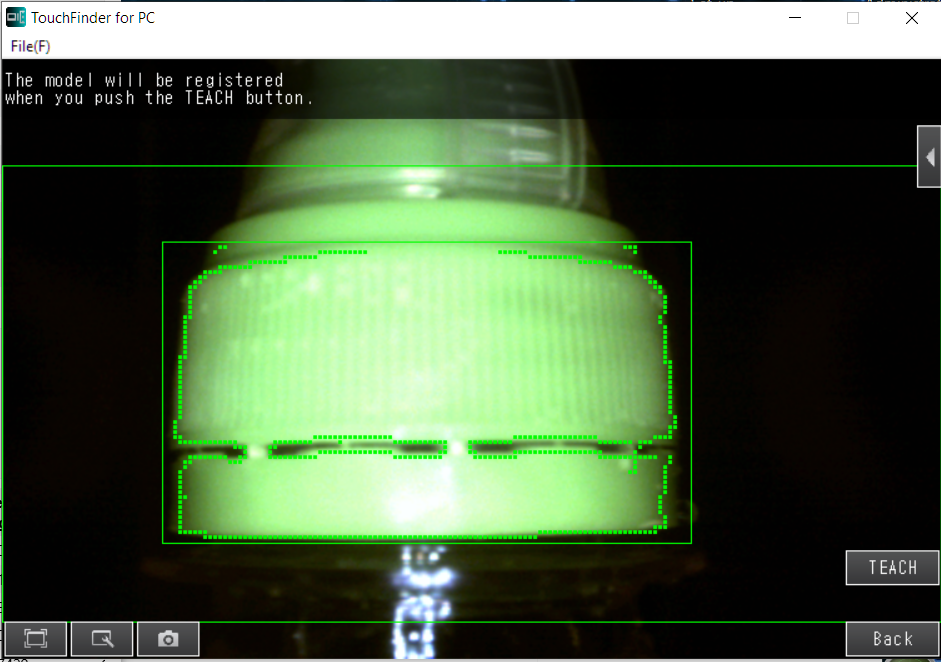
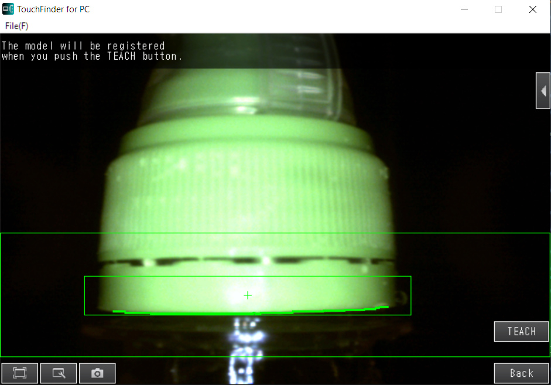
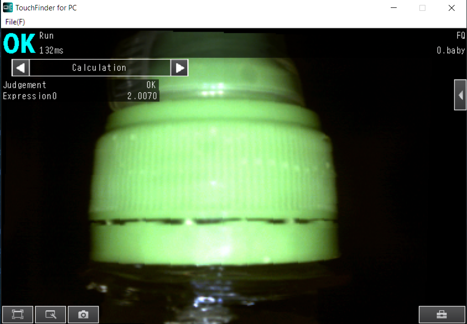
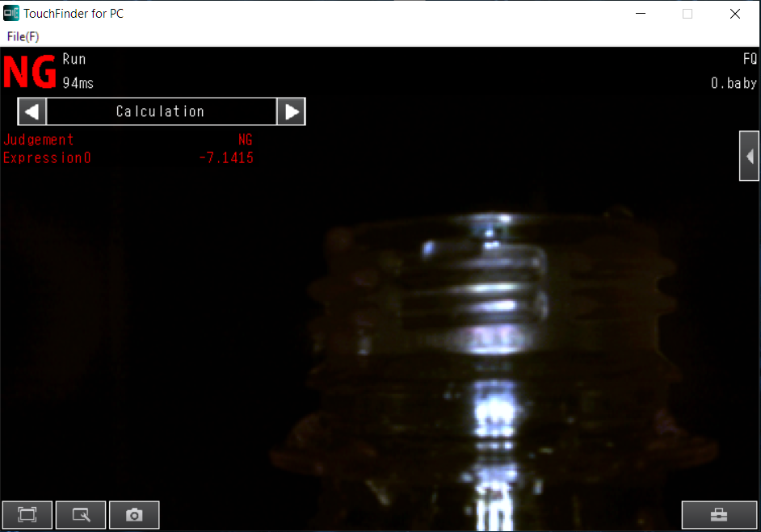
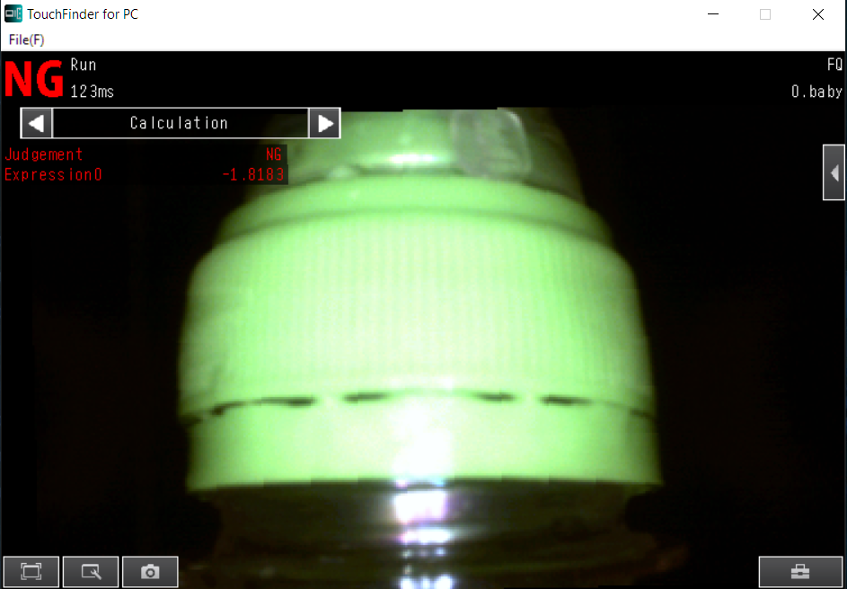

# Smart_Inspection_ML_Integration_Omron-FQ2_S7-1200-Wientek

## Общая информация о проекте

Монорепозиторий:  для оценки соответствия качества крышки бутылки например отсутствие, замятие, неправильная посадка. Логика системы отбраковки строится на трёх устройствах:
1.	 PLC Siemens S7-1200
2.	 Камера OMRON-FQ2
3.	 Панель визуализации HMI Wientek.

### Siemens S7-1200(PLC)
 отвечает за работу с датчиками, подсчёт положения бутылки относительно камеры и выталкивателя(pusher), через энкодер, работу камеры(когда фотографируем), получение результата от камеры(брак/не брак), и соответственно выталкиваем или нет бутылку с линии, сбор статистики.

### Камера OMRON-FQ2
 отвечает за обработку изображения, даёт показатели корреляции объекта, её положение и угол наклона. Камера может быть обучена на выделение множества частей одного объекта. В нашем случае это общий вид крышки бутылки, нижний край крышки. Камеру необходимо пред обучить на определённую крышку, может запомнить отдельно до 32 рецептов. В данном проекте используется 4 рецепта(крышки). Модель Логистической регрессии(LogRegressor) загружена в камеру и именно по ML принимается решение брак/не брак, которое и передаётся на Siemens S7-1200

### HMI Wientek(панель визуализации)
 визуализирует статистику работы бракиратора, даёт возможность редактировать рецепт(подстраивать количество импульсов энкодера), переключение рецептов на камере, включение-отключение отдельно камер и выталкивателя(pusher).


 ## Алгоритм работы браковщика (FIFO / Очередь сдвига)

1. **Триггер съёмки:** Бутылка пересекает датчик наличия  ПЛК фиксирует текущее значение энкодера и подает импульс на запуск камеры Omron FQ2, когда значение энкодера достигнет уставки рецепта `Координата Камера=Координата датчика + Дельта_импульсов (задается с HMI)`.
2. **Анализ:** Камера выполняет инспекцию, прогоняет признаки через LogRegressor и возвращает результат (`OK` / `NG`) в ПЛК через PROFINET.
3. **Сопровождение:** ПЛК вычисляет целевую координату энкодера для выталкивателя: `Координата выталкивания = Координата съёмки + Дельта_импульсов (задается с HMI)`. Результат помещается в программную очередь (FIFO / массив сопровождения).
4. **Отбраковка:** При достижении энкодером целевой координаты, если статус бутылки `NG`, ПЛК активирует пневмоцилиндр (Pusher).

## Расположение камер

                     [ Камера 2 (Входной контроль) ]
                                          │
                                          ▼ Зона видимости Cam2 (FOV)
   ────────────────────────────────────────────────────────────►
   Направление                                         
   движения ──────►    (Бутылка)        ────────────────────────► 
   конвейера                                 
   ────────────────────────────────────────────────────────────►
                           
                            ▲         Смещение 20 см между камерами
                            │ Зона видимости Cam1 (FOV)
                     [ Камера 1 (Выходной контроль) ]

## Схема архитектуры
```
Датчик → PLC (энкодер) → триггер камеры → FQ2 (инспекция + LogRegressor)
                                              ↓ OK/NG
                                        PLC (FIFO очередь)
                                              ↓
                                        Pusher (пневмоцилиндр)
                                              ↓
                                        HMI (статистика, рецепты)
```     


## Структура проекта

| Путь | Назначение |
|------|------------|
| `14112025cam1_2026_01_23-16_09_39_OK.csv` | Данные на которых обучалась камера 1 OMRON FQ2 не брак. Перед камерой проходил только не брак|
| `14112025cam1_2026_01_27-09_15_10_NG_part1.csv` |Данные часть 1 на которых обучалась камера 1 OMRON FQ2 брак. Перед камерой проходил только брак|
| `14112025cam1_2026_01_27-09_44_53_NG_part2.csv` | Данные часть 2 на которых обучалась камера 1 OMRON FQ2 брак. Перед камерой проходил только брак |
| `14112025cam2_2026_01_23-15_43_32_OK.csv` | Данные на которых обучалась камера 2 OMRON FQ2 не брак. Перед камерой проходил только не брак|
| `14112025cam2_2026_01_27-10_36_41_NG.csv` |Данные на которых обучалась камера 2 OMRON FQ2 брак. Перед камерой проходил только брак|
| `Camera1.ipynb` | Ноутбук содержит код Python, где предобрабатывались данные, объединялись данные брака и не брака. Обучение модели, снятие метрик. Для камеры 1|
| `Camera2.ipynb` | Ноутбук содержит код Python, где предобрабатывались данные, объединялись данные брака и не брака. Обучение модели, снятие метрик. Для камеры 2|
| `Rejector_Original_Panel.cmtp` | Файл содержит проект EasyBuilder Wientek, на котором реализованы человеко-машиный интерфейс и визуализация работы бракиратора|
| `Rejector_PLC_S7_1200_with_Omron_FQ2.zap17` | Архив проекта TIA Portal V17, так же содержит файлы EDS для поддержки в сети PROFINET камеры OMRON FQ2|
| `cam1.bkd` | Полный backup с работающий камеры 1 OMRON FQ2|
| `cam2.bkd` | Полный backup с работающий камеры 2 OMRON FQ2|
| `Image_camera1` | Директория с изображением с результатами отбраковки камеры 1|
| `Image_camera2` | Директория с изображением с результатами отбраковки камеры 2|
| `Image_sample_shape_teach_camera` | Директория с изображением образцов обучения камеры на крышку, две формы. Общий вид крышки(**P0**) и положение нижнего края крышки(**P1**). Обучение одинаково для обеих камер |

## Данные файлов CSV

Данные собирались не посредственно с помощью камер в 2 этапа. 
1. этап ~ около 1300 бутылок, не допускалось попадания под камеру брака эти файлы CSV имеют в название OK. 
2. этап логировался только брак на конвейер, перед камерами выставлялся заранее подготовленый брак в размере 200 единиц и подовался на конвейер бракиратора, в случайном положение относительно камеры, примерно ~ 600 запесей.

Ниже список итоговых признаков на которых обучалась модель логистической регрессии. 
```
0   Judge       int64  результат отбраковки брак -1, не брак 0 (фактически выставляется вручную при обработке данных, так как результат от камер не релевантен при сборе данных)  
1   P0.DY              float64 - На сколько смещён обнаруженый колпачёк относительно колпачка на котором обучилась камера
2   P0.CR              float64 - Коэффициент корреляци по общему виду крышки
3   P1.DY              float64 - На сколько смещёна крышка
4   P1.CR              float64 - Коэффициент корреляции нижний кромке крышки
5   P1.angle_sin       float64 - созданый признак, основаный на угле поворота нижней кромке крышки.
```
**Важно!!! Две формы('P0','P1') в камере  Shape Search III для логистической регрессии должны обучаться на одной объекте**

**Пример обучение 'P0', тип в камере  Shape Search III**



**Пример обучение 'P1', тип в камере  Shape Search III**



**Пример не брака**



**Пример брака**



**Пример брака**




## Итоговая формула логистической регрессии

Данная формула используется для обеих камер. Во время производствия была обнаружена, анамолия в статистических данных работ камер. Повторно проведён анализ
данных для обучения и выявлена. Если интересно можете сами провести анализ, и выявить его.

**Формула набирается в камере путь SensorSetting->Calculation->Expression**

Текущий порог для обеих камер Judgement=0

**Результат = -12.3326 + 12.2732 * ('P0.DY'+100)/(100+100) + 7.8835 * 'P0.CR'/100 - 1.8909 * ('P1.DY'+100)/(100+100) + 2.0263 * 'P1.CR'/100 - 3.4869 * ABS(SIN('P1.TH'))**


## Метрики эффективности (Данные опытно-промышленной эксплуатации)

По результатам непрерывного мониторинга на действующей высокоскоростной производственной линии (номинальный поток ~100 000 шт. / 12-часовая смена) были зафиксированы следующие показатели работы системы отбраковки:

* **Общий объем обработанной продукции:** 73 596 шт.
* **Всего извлечено из потока (уникальных бутылок брака):** 264 шт.
  * *Камера 1 (входной контроль):* 224 срабатывания.
  * *Камера 2 (выходной контроль):* 199 срабатываний.
  * *Совместное обнаружение (обе камеры):* 159 шт.
* **Результаты валидации службой ОТК:**
  * **Пропуск брака (False Positive):** 0 шт. (За время сбора статистики контролерами ОТК на выходе линии не зафиксировано ни одного случая пропуска дефектной продукции потребителю).
  * **Ложные срабатывания / Перебраковка (False Negative):** 3 шт. (Зафиксировано всего 3 случая избыточного срабатывания на 73 596 бутылок из-за динамических колебаний конвейера).

### Итоговые метрики математической модели (LogRegressor) на реальном потоке:
* **Recall (Полнота модели):** 100% — абсолютная гарантия чистоты партии от брака укупорки.
* **Precision (Точность модели):** 98.86% — высочайшая точность классификации, исключающая финансовые потери от сброса кондиционного товара.
* **False Negative Rate (Уровень ложных тревог):** 0.004% — система работает стабильно в условиях сильных вибраций и люфтов.


## Требования

- **Python 3.11**
- **TIA Portal V17** - для работы с проектом Siemens S7-1200
- **EasyBuilder** - для работы с проектом HMI Wientek
- **TouchFinder for PC** - для работы с камерой OMRON FQ2


### Запускт и установка
 Клонирование репозитория:
 git clone 

#### Лицензия

См. файл `LICENSE` в корне репозитория.
