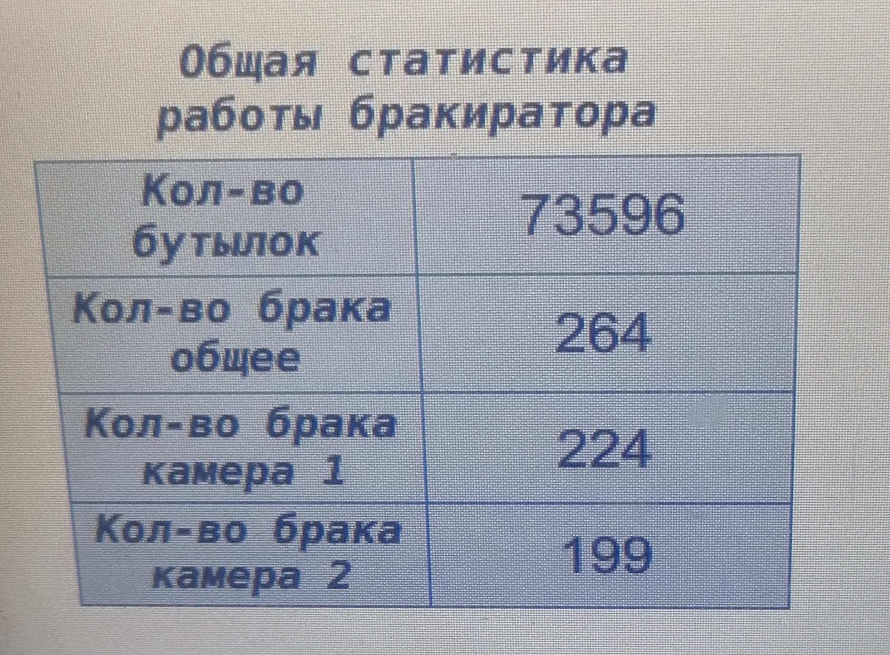

# Smart_Inspection_ML_Integration_Omron-FQ2_S7-1200-Wientek

## General Project Overview

Monorepository for quality assessment of bottle caps, e.g., detecting absence, crumpling, or incorrect seating. The rejection logic is based on three devices:

1.	PLC Siemens S7‑1200
2.	Camera OMRON‑FQ2
3.	HMI Visualization Panel Wientek.

### Siemens S7‑1200 (PLC)

Responsible for:
- Handling sensors;
- Calculating the bottle position relative to the camera and pusher using an encoder;
- Triggering the camera (when to take a photo);
- Receiving the result from the camera (OK / NG);
- Activating the pusher to eject defective bottles;
- Collecting statistics.

### Camera OMRON‑FQ2

Responsible for image processing and providing object correlation metrics, position, and tilt angle. The camera can be trained to detect multiple parts of a single object. In this project, it inspects the overall view of the bottle cap and the lower edge of the cap.

The camera can store up to 32 separate recipes. This project uses 4 recipes (cap types). A Logistic Regression model (LogRegressor) is loaded into the camera; ML‑based decision (OK/NG) is made inside the camera and transmitted to the Siemens S7‑1200.

### HMI Wientek (Visualization Panel)

Provides visualization of the rejector’s statistics and allows:
- Editing recipes (adjusting encoder pulse counts);
- Switching camera recipes;
- Individually enabling/disabling cameras and the pusher.

## Rejector Operation Algorithm (FIFO / Shift Queue)

1. **Capture Trigger:** When a bottle crosses the presence sensor, the PLC records the current encoder value and triggers the Omron FQ2 camera when the encoder reaches the recipe setpoint:  
   `Camera Coordinate = Sensor Coordinate + Delta Pulses` (set via HMI).
2. **Analysis:** The camera performs inspection, runs features through the LogRegressor, and returns the result (`OK` / `NG`) to the PLC via PROFINET.
3. **Tracking:** The PLC calculates the target encoder coordinate for the pusher:  
   `Pusher Coordinate = Capture Coordinate + Delta Pulses` (set via HMI).  
   The result is stored in a software queue (FIFO / tracking array).
4. **Rejection:** When the encoder reaches the target coordinate and the bottle status is `NG`, the PLC activates the pneumatic cylinder (Pusher).

## Camera Layout

```
                 [ Camera 2 (Incoming Inspection) ]
                                      │
                                      ▼ Field of View (FOV) of Cam2
────────────────────────────────────────────────────────────►
Direction of
conveyor movement ──────► (Bottle) ────────────────────────►
────────────────────────────────────────────────────────────►


                        ▲         Offset of 20 cm between cameras
                        │ Field of View (FOV) of Cam1
                 [ Camera 1 (Outgoing Inspection) ]
```

## Architecture Diagram
```
Sensor → PLC (encoder) → camera trigger → FQ2 (inspection + LogRegressor)
                                                    ↓ OK/NG
                                                    PLC (FIFO queue)
                                                    ↓
                                                    Pusher (pneumatic cylinder)
                                                    ↓
                                                    HMI (statistics, recipes)

```

## Project Structure

| Path | Purpose |
|------|---------|
| `14112025cam1_2026_01_23-16_09_39_OK.csv` | Training data for Camera 1 (OMRON FQ2), OK samples only. Only non‑defective caps passed in front of the camera. |
| `14112025cam1_2026_01_27-09_15_10_NG_part1.csv` | Training data part 1 for Camera 1, NG samples only. Only defective caps passed in front of the camera. |
| `14112025cam1_2026_01_27-09_44_53_NG_part2.csv` | Training data part 2 for Camera 1, NG samples only. Only defective caps passed in front of the camera. |
| `14112025cam2_2026_01_23-15_43_32_OK.csv` | Training data for Camera 2 (OMRON FQ2), OK samples only. Only non‑defective caps passed in front of the camera. |
| `14112025cam2_2026_01_27-10_36_41_NG.csv` | Training data for Camera 2, NG samples only. Only defective caps passed in front of the camera. |
| `Camera1.ipynb` | Jupyter notebook with Python code for data preprocessing, merging OK/NG data, model training, and metrics calculation for Camera 1. |
| `Camera2.ipynb` | Jupyter notebook with Python code for data preprocessing, merging OK/NG data, model training, and metrics calculation for Camera 2. |
| `Rejector_Original_Panel.cmtp` | EasyBuilder Wientek project file containing the HMI and visualization of the rejector operation. |
| `Rejector_PLC_S7_1200_with_Omron_FQ2.zap17` | TIA Portal V17 project archive, includes EDS files for PROFINET support of the OMRON FQ2 camera. |
| `cam1.bkd` | Full backup of the working Camera 1 (OMRON FQ2). |
| `cam2.bkd` | Full backup of the working Camera 2 (OMRON FQ2). |
| `Image_camera1` | Directory with sample images showing Camera 1 rejection results. |
| `Image_camera2` | Directory with sample images showing Camera 2 rejection results. |
| `Image_sample_shape_teach_camera` | Directory with training sample images for camera teaching; two shapes. Overall cap view (**P0**) and lower edge position (**P1**). Teaching is identical for both cameras. |

## CSV Data Description

Data was collected directly from the cameras in two stages:

1. Stage 1: ~1300 bottles; no defects were allowed under the camera. These CSV files are marked with `OK` in the filename.
2. Stage 2: Only defective samples were logged. Pre‑prepared defects (~200 units) were fed onto the conveyor in random positions relative to the cameras, yielding approximately ~600 records.

### Final Features Used for Logistic Regression Training

| Index | Feature | Type | Description |
|-------|---------|------|-------------|
| 0 | Judge | int64 | Rejection result: defect = -1, no defect = 0. Manually assigned during data processing because camera results were not relevant for data collection. |
| 1 | P0.DY | float64 | Offset of the detected cap relative to the taught cap. |
| 2 | P0.CR | float64 | Correlation coefficient for the overall cap view. |
| 3 | P1.DY | float64 | Offset of the cap (for lower edge). |
| 4 | P1.CR | float64 | Correlation coefficient for the lower edge of the cap. |
| 5 | P1.angle_sin | float64 | Derived feature based on the rotation angle of the lower edge. |

**Important:** Both shapes (**P0**, **P1**) in the camera’s Shape Search III must be trained on the same object.

**Example of ‘P0’ training (Shape Search III type in the camera)**


**Example of ‘P1’ training (Shape Search III type in the camera)**


**Example of OK sample**


**Example of NG sample**


**Example of NG sample**


## Final Logistic Regression Formula

This formula is used for both cameras. During production, an anomaly in the camera statistics was detected. Data was re‑analyzed and a data collection error was identified. If you’re interested, you can perform your own analysis to identify it. Feel free to reach out if you’d like to discuss it.

**Formula is entered in the camera: SensorSetting → Calculation → Expression**

Current judgment threshold for both cameras: `Judgement = 0`.

**Result = -12.3326 + 12.2732 * ('P0.DY'+100)/(100+100) + 7.8835 * 'P0.CR'/100 - 1.8909 * ('P1.DY'+100)/(100+100) + 2.0263 * 'P1.CR'/100 - 3.4869 * ABS(SIN('P1.TH'))**

## Performance Metrics (Pilot Industrial Operation)

**HMI Panel Screenshot – Statistics**



Based on continuous monitoring on a high‑speed production line (nominal throughput ~100,000 units per 12‑hour shift), the following rejection performance was recorded:

* **Total processed products:** 73,596 units.
* **Total removed from the flow (unique defective bottles):** 264 units.
  * *Camera 1 (incoming inspection):* 224 activations.
  * *Camera 2 (outgoing inspection):* 199 activations.
  * *Detected by both cameras:* 159 units.
* **QC Validation Results:**
  * **Missed defects (False Negative):** 0 units. (During the statistics collection period, QC inspectors did not detect any defective product reaching the customer.)
  * **False alarms / Over‑rejection (False Positive):** 3 units. (Only 3 cases of unnecessary rejection out of 73,596 bottles due to dynamic conveyor vibrations.)

### Final Mathematical Model Metrics (LogRegressor) on Real Production Flow

* **Recall (Sensitivity):** 100% — guarantees that no defective capping reaches the customer.
* **Precision:** 98.86% — high classification accuracy, minimizing financial loss from rejecting good product.
* **False Alarm Rate:** 0.004% — stable operation under strong vibrations and mechanical backlash.

## Requirements

- **Python 3.11**
- **TIA Portal V17** — for working with the Siemens S7‑1200 project.
- **EasyBuilder** — for working with the Wientek HMI project.
- **TouchFinder for PC** — for working with the OMRON FQ2 camera.

## Setup and Installation

Clone the repository:

```bash
git clone <https://github.com/Andrey-EE-ML-ICS/Smart_Inspection_ML_Integration_Omron-FQ2_S7-1200-Wientek>


License
See the LICENSE file in the repository root.